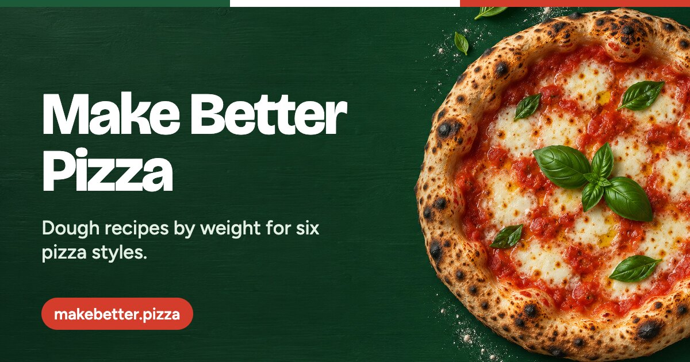

# Ultimate Pizza Dough Calculator

A modern, responsive web application for calculating perfect pizza dough recipes with precise baker's percentages.



## 🍕 Live Demo

Visit the live application: [Make Better Pizza](https://makebetter.pizza)

## ✨ Features

- **Three steps**: choose a style, set the size, read the recipe. One step per screen on a phone, three columns on a desktop
- **Six styles**: Neapolitan, New York, Sicilian, Detroit, Pan, and Focaccia, each with its own presets
- **Remembers your last recipe**: a returning visitor lands on the recipe they left (saved in the browser only)
- **Fine-tuning one tap away**: salt, yeast type and amount, oil, sugar, malt, and a preferment (poolish, biga, sponge, sourdough)
- **Weights like a kitchen scale**: grams with ounces beside them and baker's percentages
- **Method and baking steps** with the real weights in the text
- **English and Turkish**, light and dark themes, centimetres or inches
- **Installable** on a phone home screen

## 🛠️ Technology Stack

- **React + TypeScript + Vite**
- **Plain CSS** with custom properties (`src/index.css` tokens, `src/design/design.css` components)
- **Motion**: browser View Transitions, `@number-flow/react`, `@formkit/auto-animate`
- **Checks**: `npm test` runs assert-based checks of the dough maths and the rules around it (`src/utils/*.check.ts`)
- **Google Analytics**: user interaction tracking

## 📊 Analytics

The application includes Google Analytics to track user interactions and improve the user experience. The following events are tracked:

- Page views
- Pizza style selections
- Preferment type selections
- Yeast type selections
- Unit changes (inches/centimeters)
- Theme changes (light/dark)
- Step views (style/size/recipe)
- Recipe generations
- Start over, copy and print actions
- Shape toggles (round/rectangular)

## 🚀 Getting Started

### Prerequisites

- Node.js (v16 or higher)
- npm or yarn

### Installation

1. Clone the repository:
   ```bash
   git clone https://github.com/chakkale/UltimatePizzaDough.git
   cd UltimatePizzaDough
   ```

2. Install dependencies:
   ```bash
   npm install
   # or
   yarn install
   ```

3. Start the development server:
   ```bash
   npm run dev
   # or
   yarn dev
   ```

4. Open your browser and navigate to `http://localhost:5173`

### Building for Production

```bash
npm run build
# or
yarn build
```

The build artifacts will be stored in the `dist/` directory.

## 🌐 Deployment

This project uses:
- **GitHub** for version control
- **GitHub Actions** for CI (build + lint only, `.github/workflows/ci.yml`)
- **Cloudflare Workers** (static assets, built by Workers Builds) for hosting at https://makebetter.pizza

Config lives in `wrangler.jsonc`; security headers in `public/_headers`. A push to `main` deploys.

Full details: [docs/cloudflare-migration.md](docs/cloudflare-migration.md).

## 📱 PWA Features

The application is configured as a Progressive Web App (PWA), allowing users to install it on their devices. It includes:

- Home screen icons
- Splash screens
- Full-screen mode

## 🤝 Contributing

Contributions are welcome! Please feel free to submit a Pull Request.

1. Fork the repository
2. Create your feature branch (`git checkout -b feature/amazing-feature`)
3. Commit your changes (`git commit -m 'Add some amazing feature'`)
4. Push to the branch (`git push origin feature/amazing-feature`)
5. Open a Pull Request

For more details, see [CONTRIBUTING.md](CONTRIBUTING.md).

## 📄 License

This project is licensed under the MIT License - see the [LICENSE](LICENSE) file for details.

## 🙏 Acknowledgements

- Created with ❤️ for pizza enthusiasts everywhere
- Pizza icon designed by chakkale (and Cursor/Claude Sonnet 3.7)
- Special thanks to the pizza community for feedback and suggestions

---

Made with passion by chakkale (and Cursor/Claude Sonnet 3.7)
